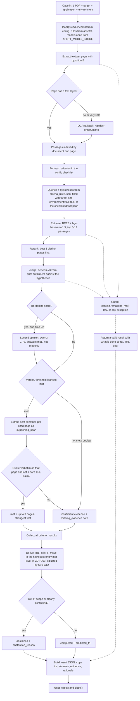

# trl-tracer — Base Plan

**Trace every readiness claim to the page that proves it.**

Evidence-backed TRL assessment of technical reports, for the 2nd APCTT Hackathon 2026
("AI for Technology Readiness"). Track: Philippines. Package id: `trl-tracer`.

Source of truth: the kit docs in `apctt-participant-kit-0.5.0-cpu/docs/participant/`
(`PROBLEM_DESCRIPTION.md`, `MODULE_GUIDE.md`, `SUBMISSION.md`, `MODEL_CATALOG.md`).
Where the website and the kit disagree, the kit is newer (0.5.0) and wins; the website says
official announcements override it.

## 1. What we are building

One file that matters: `participant_module/adapter.py` with a class `AssessmentModule`
(`load` -> `assess` -> `reset_case` -> `close`). The organizers' server runs it once per case,
in a fresh process, offline, with 3 minutes per case including model load.

- **Input:** a case with one PDF (a USGS technical report, median 44 pages), an assessment
  target, an intended application and an intended environment.
- **Output:** a JSON result with
  1. a TRL 1-9, or an abstention with a reason,
  2. a status for each of the 12 criteria of `APCTT-2026-CHECKLIST-v1`
     (`met` / `not met` / `insufficient evidence`),
  3. for every `met` criterion: up to 3 (document, page) items, best first, each with a short
     quote copied from that page.
- **Purpose:** help assessors judge technology maturity before transfer or funding, by showing
  the evidence page by page instead of making them reread the report.
- No UI in Stage 1. The Stage 2 web system is built on site at the event, only if we qualify.

## 2. Key dates and how we work

| Date | What |
|---|---|
| **2026-11-15, 23:59 IST** | **Stage 1 final deadline** = **2026-11-16, 02:29 PHT**. Google Form: https://forms.gle/sU21rDGVDULzWExY9 |
| 2026-12-01 | Finalists announced |
| 2026-12-16/17 | Stage 2, Techfest, IIT Bombay (web system built on site; Node.js available) |

Up to two submissions; the latest valid one by the deadline is the final model. No third
submission. A team with no valid submission is not scored.

**How we work:** flexible, continuous, iterative and incremental development, with no fixed
schedule. Work proceeds in ordered increments (tickets), each ending runnable, scored by the
harness and committed. We finish the **full product** and submit it as Submission 1; if the
loop finds an improvement, it goes in as Submission 2. The always-abstain package is built first
and kept as an emergency fallback, uploaded only if the full product cannot pass the gates
before the deadline.

- **Spec:** `.scratch/trl-tracer/spec.md` (problem, user stories, implementation and testing decisions).
- **Tickets:** `.scratch/trl-tracer/issues/01-…18-…`, one file each, with `Status:`, `Owner:`,
  `Blocked by:` and a definition of done. The next ticket is the lowest-numbered open one whose
  blockers are all done.
- **Team:** solo, team name `adzu`. The agent builds the plumbing, harness, labelling tool and
  first versions of judging and the TRL rule; the participant owns tuning, the criterion cards,
  the hand labels and every keep/revert decision.

## 3. Scoring (what we optimise)

`total = 0.45 A + 0.40 B + 0.15 C`

- **A, TRL (45%):** exact 1.0, off by 1 = 0.5, off by 2+ = 0, abstain = 0.25 (1.0 if experts
  find no TRL determinable), failed = 0.
- **B, criterion evidence (40%):** for criteria the experts label `met`, we score only if we
  also say `met` **and** one of our first 3 distinct cited pages is a gold page. For the other
  criteria, we score if we do *not* say `met`. `B = (2 x met part + 1 x not-established part) / 3`.
- **C, expert review (15%):** 6 sampled `met` claims, judged on their **first** evidence item.
  SUPPORTS = 1, PARTIAL/NOT_SUPPORTS or missing `supporting_span` = 0, FABRICATED = -1.
  A bare "reached TRL X" sentence is never evidence.
- A `failed` case (error, invalid output, timeout, OOM) scores 0 in A and B.

What follows from this:

- **Lean towards `met`.** The met part counts double, and a wrong `met` only costs the
  not-established part. Claim `met` when the best page is plausibly right, not only when it
  is certain. Tune the threshold on hand-labelled cases.
- **Cite 3 pages per `met`**, best first. More pages raise the chance of hitting a gold page;
  only the first item is judged in C, so it must be the strongest quote.
- **Prefer a TRL over abstaining.** Estimated TRL in the public set: 6 in 54 of 99, 7 in 29,
  5 in 12, 4/8/9 in 4. The hidden set is spread over "the SDGs and TRL levels of the public set",
  so always answering 6 would score about 0.75 on A, against 0.25 for always abstaining.
  Watch for the organizer's published TRL-band composition of the hidden set and update the
  prior if it differs.

## 4. Approach: retrieve, then verify

Not free-form generation: a fabricated quote costs -1 and big models cannot cold-start in 3 minutes.

For each criterion in the checklist:

1. **Extract** page text with `pypdfium2` (pypdf can take 12+ s on a single page). OCR fallback
   with `rapidocr-onnxruntime` only for pages with little or no text (USGS-SDG-030 is scanned).
   Split pages into passages of a few sentences, keeping the page number.
2. **Build the queries** from the rules file (`assets/criteria_rules.json`, from the second
   brain): search phrases and short hypotheses per criterion, filled in with the case's
   `assessment_target`, `intended_application` and `intended_environment`. If a criterion ID is
   not in the rules file, use the checklist description itself, so a changed checklist still works.
3. **Retrieve** candidate passages: BM25 + dense embeddings, top 8-12 passages.
4. **Rerank** and keep the best 3 distinct pages.
5. **Judge** with an entailment model: does the passage entail the criterion hypothesis?
   A small LLM gives a second opinion only on borderline scores, if time allows.
6. **Quote** by extracting the best sentence from the page text and checking in code that it
   appears in that page's text. A model never writes the quote. Reject sentences that only
   assert a TRL number.
7. **Derive the TRL** (not a strict ladder: reports often skip early stages):
   - start from the prior (6);
   - move to the highest of C04-C09 that is met with a strong score;
   - move down only when the strongest evidence is clearly early-stage (lab or concept only);
   - keep within the 5-7 band unless the evidence for a level outside it is strong, since
     off by 1 still earns 0.5.
   Abstain only when the report is out of scope or the evidence clearly conflicts.
8. **Never fail:** wrap everything, return a schema-valid result, watch
   `context.remaining_ms()` and return a valid result (with the TRL prior) before the limit.

### How it works (per case)

Each case runs in a fresh process: `load()` once, then `assess()`, within 3 minutes total.
The diagram renders on GitHub and in most Markdown viewers that support Mermaid.



What each part protects against:

- **Quote check (O):** quotes come only from the page text, so a fabricated quote (-1 in C)
  cannot be produced, and bare TRL claims (NOT_SUPPORTS) are filtered out.
- **Rerank to top 3 (I):** score B only looks at the first 3 distinct cited pages.
- **Downgrade path (Q):** a `met` without evidence would make the result invalid
  (`INVALID_OUTPUT`, score 0), so it becomes `insufficient evidence` instead.
- **Guard (Y/Z):** a timeout, out-of-memory error or crash scores 0 in A and B. A result built
  from partial work with the TRL prior keeps most of A.
- **Checklist from config (G, G2):** criterion IDs are never hard-coded; unknown IDs fall back
  to their description.

### Models (all from the catalogue, loaded offline from `APCTT_MODEL_STORE`)

| Job | Model | Notes |
|---|---|---|
| Retrieval | `bge-base-en-v1.5` (MIT, 109M) + BM25 | CPU-friendly |
| Reranking | `granite-embedding-reranker-english-r2` or `ms-marco-minilm-l6-v2` | CPU-friendly |
| Judge | `deberta-v3-base-zeroshot-v2.0-c` (MIT, 184M) | zero-shot entailment, CPU |
| Second opinion | `qwen3-1.7b` (bf16, thinking off) | optional; only if load + use fits the budget |
| Later, GPU only | `qwen3-4b-instruct-2507-nf4` | unmeasured; reloads ~8 GB per case |

Start with `compute.device = cpu` (scored identically, no VRAM or load-time risk, runs on a Mac).
No training: there are no expert labels, only the organizer's rough TRL estimates.

**Time budget (target on a Mac: under 90 s per case, to leave margin for the event's 4-core
Linux laptop):** model load, text extraction, embedding of up to ~200 pages, reranking and
12 x 3 entailment checks. Measure each step on USGS-SDG-017 (49 MB) and USGS-SDG-075
(208 pages) before adding the LLM.

## 5. Second brain: what counts as TRL evidence

Based on Tiago Forte's *Building a Second Brain* (CODE: Capture, Organize, Distill, Express),
kept small: one folder, plain Markdown and JSON, no extra tools. The goal is not notes for their
own sake: the distilled output is a rules file that the module reads.

### Where it lives

```text
apacHackathon/
├── brain/                          our notes; NOT part of the submission
│   ├── criteria/                   one card per criterion (Organize)
│   │   ├── C01-basic-principles.md
│   │   ├── ...
│   │   └── C12-evidence-matches-target.md
│   ├── captures.jsonl              raw evidence snippets found while reading (Capture)
│   ├── labels/                     hand labels per public case: status + gold pages
│   ├── experiments.md              each run: settings, results, what changed
│   ├── decisions.md                choices made and why (thresholds, models, TRL rule)
│   └── sources.md                  every data source and its licence (feeds declaration.json)
└── my_submission/
    └── assets/criteria_rules.json  the distilled rules the module loads (Express)
```

### The loop

| Step | What we do | When |
|---|---|---|
| **Capture** | While reading reports or reviewing module output, save a line to `captures.jsonl`: case, page, criterion, `met` / `trap`, the quote, and why. | Every time we read a report or a result |
| **Organize** | File each capture under its criterion card, as a positive example, a trap or an edge case. | Daily |
| **Distill** | Rewrite each card's top section: 2-4 short hypotheses and 5-10 search phrases; list trap cues. | Before each pipeline run |
| **Express** | Export the distilled sections to `assets/criteria_rules.json`; later, reuse them for the README, `declaration.json` and the Stage 2 explanations. | Before each run and each submission |

Then the module's errors on the public cases become new captures, and the loop repeats.

### Criterion card template

```markdown
# C06 — Prototype in relevant environment (TRL 6)

## Distilled (exported to criteria_rules.json)
- Hypotheses:
  - "A representative prototype of the {target} was demonstrated in {environment}."
  - "The model was applied and evaluated at a field site similar to its intended use."
- Search phrases: field test, pilot study, demonstrated at, validation site, applied to the ... basin
- Trap cues: "reached TRL 6"; results of the parent project only; planned or future tests

## What it means
Plain definition in our own words, from the checklist text and NASA TRL definitions.

## Reading it for software, models and data products
The kit says hardware words are read by analogy: a representative version of the product,
tested as the criterion says. Example: a hydrologic model calibrated and validated on a real
watershed similar to the intended environment.

## Positive examples
- USGS-SDG-0xx p.14: "..." — why it counts

## Traps (looks like evidence, is not)
- USGS-SDG-0xx p.3: "..." — why it does not count

## Open questions
- Cases where the experts might disagree
```

### Rules file format (read by the module)

```json
{
  "version": "trl-tracer-rules-v1",
  "criteria": {
    "APCTT-C06": {
      "hypotheses": ["A representative prototype of the {target} was demonstrated in {environment}."],
      "queries": ["field test", "pilot study", "validated at"],
      "trap_patterns": ["TRL\\s*\\d"]
    }
  }
}
```

- Placeholders such as `{target}` and `{environment}` are filled from the case fields.
- A criterion ID missing from the file falls back to the checklist description, so the module
  still passes the changed-checklist test (MODULE_GUIDE §8 step 6).
- The rules are our own writing, under MIT. Keep report quotes out of the rules file: the
  examples stay in `brain/`.

### What it is for, and what it is not

- For: sharper queries and hypotheses (the biggest lever for retrieval and entailment),
  consistent hand labels, a record of decisions, and a ready-made data declaration.
- Not: a knowledge base the module searches at run time. Only `participant_module/` and
  `assets/` ship, and nothing is read from outside them.
- Keep it light: mostly the reading and labelling of public reports we do anyway. Skip PARA
  folders and progressive summarisation.

## 6. Steps

### Phase 0 — Setup (needs network and your approval)
- [x] Create a git repository for the project folder itself (`git init` in `apacHackathon/`).
      The current repository root is the home folder, which tracks unrelated files.
- [ ] Ask the organizers how the Philippines track selects finalists
      (website: 5 PH finalists; kit: top 40 overall + within standard error). WhatsApp group:
      https://chat.whatsapp.com/F2SW7hDmByv0BKSh5YIBYT
- [ ] Watch the 1 Oct orientation recording: https://youtu.be/-3a_45gK9DI
- [x] Build the base environment: `tools/make_env.py --base-dir <DIR>` (CPU build on macOS), then
      `tools/make_env.py --check --base-dir <DIR>`. Note the printed Python for `worker.python`.
- [x] Install the server env: `uv venv --python 3.12 .venv` and the lock files (QUICKSTART §2).
- [x] Download models: `tools/get_models.py ... --store <DIR>` (bge-base-en-v1.5, both rerankers, deberta-v3-base-zeroshot-v2.0-c, qwen3-0.6b, qwen3-1.7b)
- [x] Download the 99 public cases (about 1.1 GB): `tools/get_public_cases.py` (README step 7),
      with `--labels` for the reference TRLs and `--smoke` for the 3 diagnostic cases
      (USGS-SDG-012, -040, -061).
- [x] Copy `config/dev.json` to `config/my.local.json` with our paths (MODULE_GUIDE §8).
- [x] Create `brain/` with the 12 empty criterion cards and `sources.md`.

### Phases 1-4 — Build, loop and submit

Tracked as tickets in `.scratch/trl-tracer/issues/` (see section 2): fallback package (01),
harness (02), decision step (03), adapter and guard (04), text (05), rules file (06),
retrieval (07), entailment (08), fast cycle and sweeps (09), labelling tool (10), hand labels
(11), LLM second opinion (12), OCR (13), hardening and packaging (14), Submission 1 (15),
tuning loop (16), `qwen3-1.7b` experiment (17), Submission 2 (18).

### Phase 5 — If we qualify (Stage 2, on site)
- [ ] Prepare while waiting: the front-end design only (no code upload in advance). Bundle all
      libraries, fonts and icons; no CDN; check with `tools/check_licenses.py --web`.
- [ ] Web app calls `POST /v1/assessments` then `GET` the job; shows the TRL and, per criterion,
      its status and evidence page next to the original PDF page. Reuse the card definitions
      from `brain/` as the explanations shown to the assessor.
- [ ] Do not retrain or replace the frozen package.

## 7. Rules to remember

- Own work is licensed **MIT** (`participant_module/LICENSE`, `"license": "MIT"` in `submission.json`).
- Only catalogue models, loaded offline with `local_files_only=True` and `HF_HUB_OFFLINE=1`.
- No extra packages: the base environment is fixed. Pure-Python third-party modules may be copied
  in with their licences listed. No compiled extensions, wheels, venvs or symlinks.
- Zip at most 2 GB; no network; 3 minutes per case, including load; a timeout is never re-run.
- Disqualification: touching the network, hidden cases or other teams' files; declaring public
  weights as team-trained; sharing code with another team.
- Use a new `request_id` after each code change when testing locally.

## 8. Open questions

- How does the Philippines track select finalists (5 of 20 on the website vs top 40 overall in the kit)?
- When does feedback from Submission 1 come back? The kit says the organizer announces it.
- Has the organizer published the hidden set's TRL-band composition? It sets the TRL prior.
- Are the GPU measurements of the 4-bit models published? Until then, plan on CPU.
- Team name and the `team` / `package_id` values for `submission.json`.
- Who is on the team (max 3, all aged 35 or under on 17 Dec 2026).
